<p align="center">
  
</p>

```text
augie@x0r909:~$ whoami
Cybersecurity Engineering student — Indonesia
Builds: secure systems, network infrastructure, AI/ML tooling
Current: openforensic-imager, atlas
```

## 🧰 Arsenal

<p>
  <br/>
  
</p>

<p>
  
  
  
  
</p>

## 🚀 Selected Work

| Project | What it is | Stack |
|---|---|---|
| **[openforensic-imager](https://github.com/x0r909/openforensic-imager)** | Forensically sound disk imaging — architecture, security model, and test strategy are specified up front | `Rust` `C/C++` `CMake` |
| **[atlas](https://github.com/x0r909/atlas)** | Autonomous, agentic crypto trading system | `Python` `TypeScript` |
| **[AetherOS](https://github.com/x0r909/AetherOS)** | Learning OS/kernel development from scratch — bootloader to userspace | `C` `Assembly` |
| **[LinuxDev-Manager](https://github.com/x0r909/LinuxDev-Manager)** | Laragon-like local dev environment manager for Linux | `Python` |
| **[SIMRS](https://github.com/x0r909/SIMRS)** | Hospital management information system | `TypeScript` |

## 📊 Stats

<p align="center">
  
  
</p>

<p align="center">
  
</p>

## 🐍 Contribution Snake

<p align="center">
  <picture>
    <source media="(prefers-color-scheme: dark)" srcset="https://raw.githubusercontent.com/x0r909/x0r909/output/github-contribution-grid-snake-dark.svg" />
    
  </picture>
</p>

## 📫 Contact

<p>
  <a href="mailto:augie.aristitoazka@gmail.com"></a>
  <a href="https://www.linkedin.com/in/augiearistito"></a>
  <a href="https://github.com/x0r909"></a>
</p>

<p align="center"><em>Build secure. Learn continuously. Innovate with purpose.</em></p>
